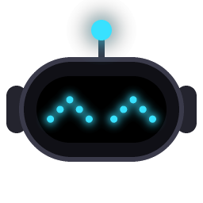
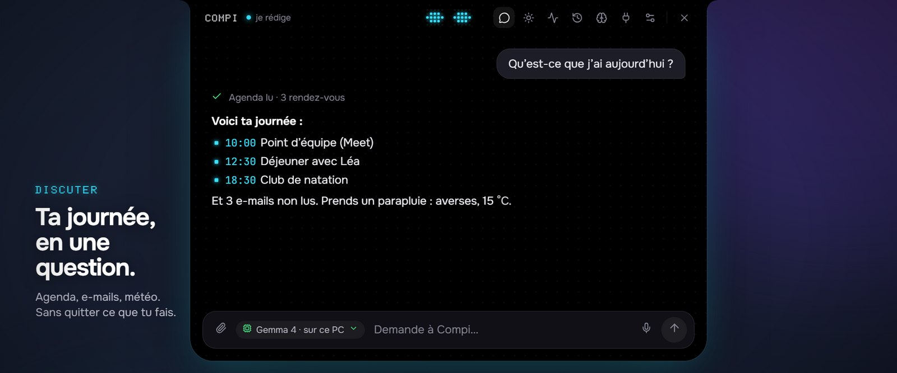
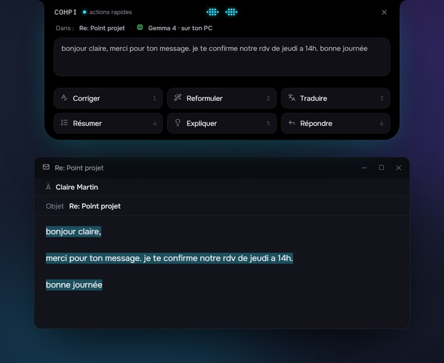
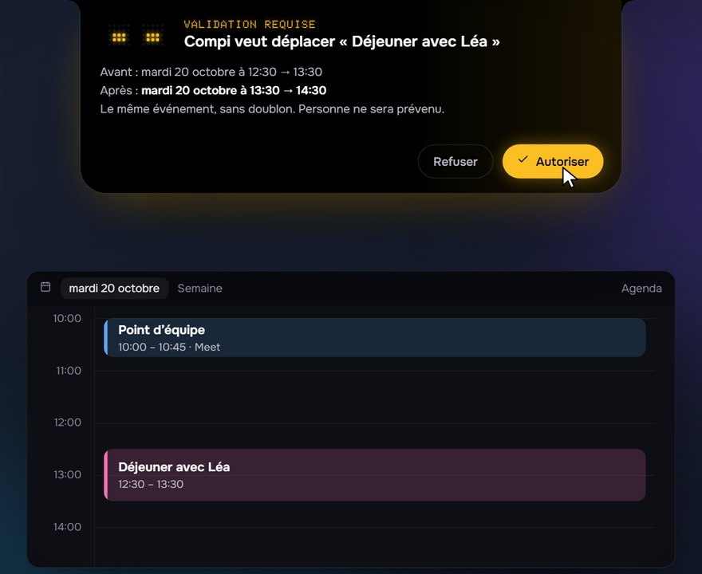
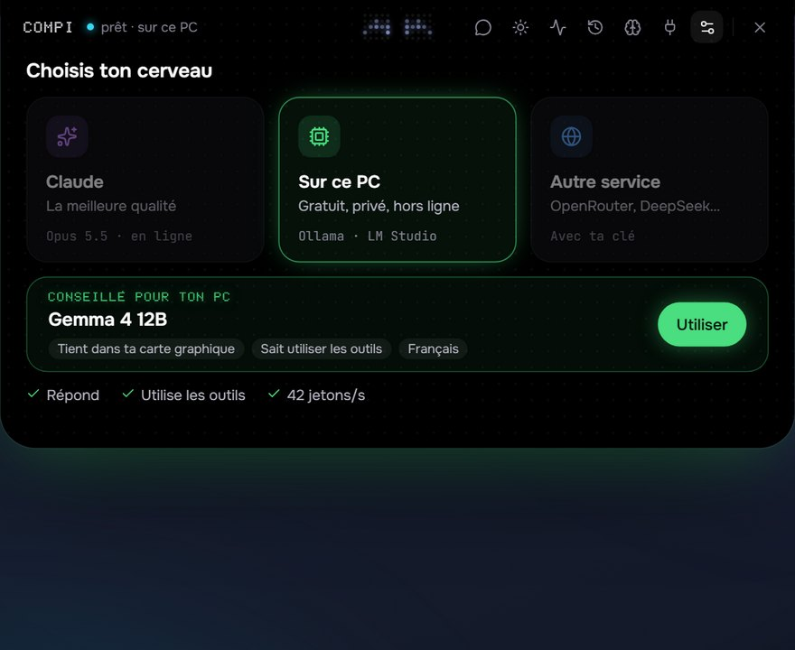
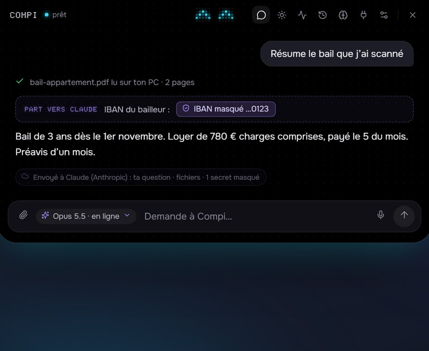
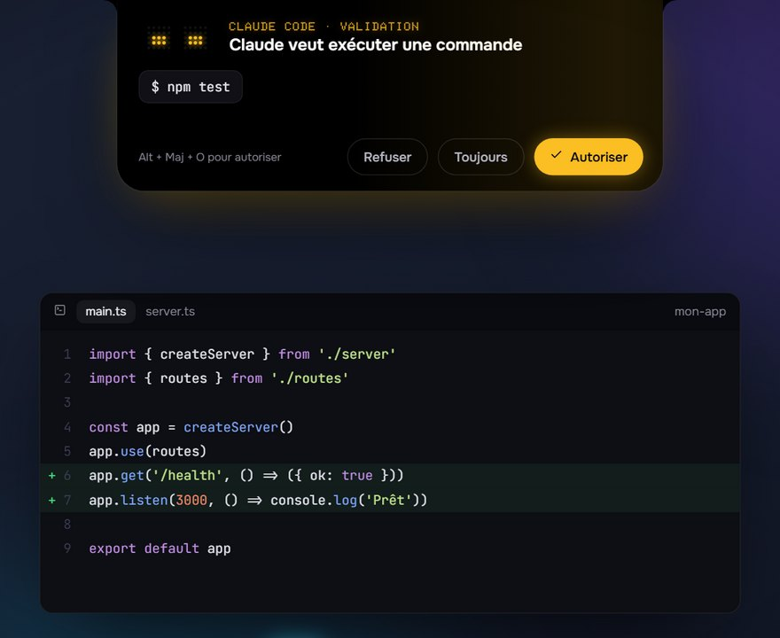
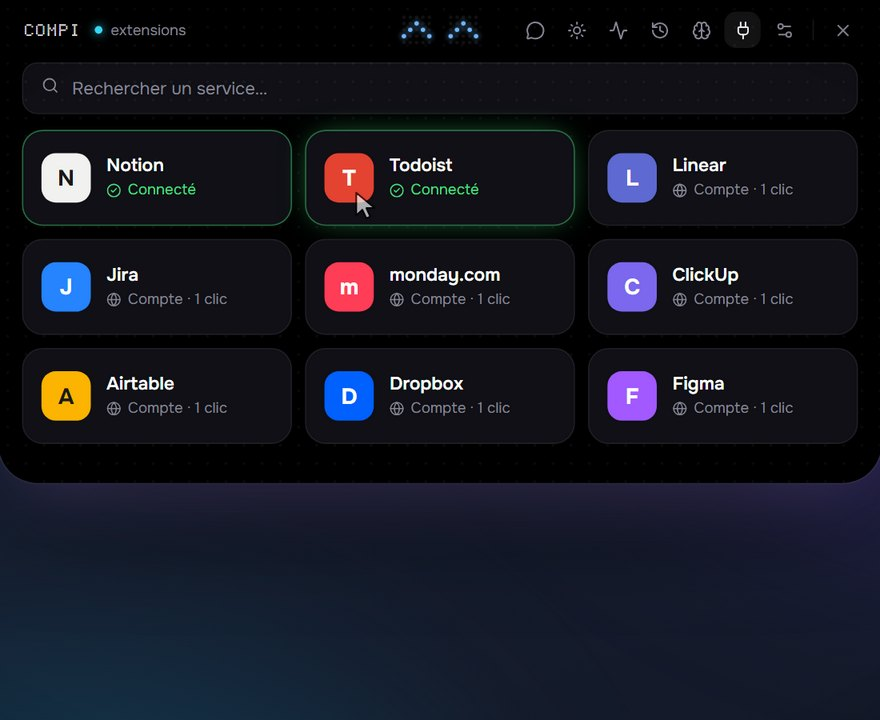

<p align="center">
  
</p>

<h1 align="center">Compi</h1>

<p align="center">
  <b>Ton compagnon IA, toujours là en haut de l'écran Windows.</b><br>
  Il discute, agit sur ton PC avec ton accord, et peut tourner 100 % en local.
</p>

<p align="center">
  <a href="LICENSE"></a>
  
  <a href="https://github.com/Dilraj7/Compi/actions/workflows/ci.yml"></a>
</p>

<p align="center">
  
</p>

Compi vit dans un « îlot » noir collé en haut de l'écran, à la manière du Dynamic Island, avec le visage d'un petit robot aux yeux LED. Au repos, c'est une pastille. Un clic ou un raccourci, et il s'ouvre.

## Ce qu'il sait faire

- **Ta journée en une question** : agenda (Google, lien `.ics` ou connecteur), e-mails Gmail, météo, rappels.
- **Actions rapides** sur n'importe quel texte sélectionné, dans toutes tes applis : corriger, reformuler, traduire, résumer.
- **Il agit, avec ton OK** : déplacer un rendez-vous, ranger un dossier, régler le son, ouvrir une appli. Une carte avant chaque action.
- **Parle-lui** : ta voix est transcrite sur ton PC, jamais envoyée. Il peut aussi te répondre à voix haute.
- **Tes documents** : PDF (même scannés), Word, Excel, et une recherche qui comprend le sens.
- **Connecteurs en un clic** : Notion, Todoist, Linear, Jira… Et tes sessions Claude Code, pilotées depuis l'îlot.
- **Routines et mémoire** : « chaque lundi à 9 h, résume mes e-mails », et ce qu'il sait de toi, que tu lis et corriges.
- **Un îlot vivant** : musique en cours, minuteur, alerte avant chaque réunion.

<table>
  <tr>
    <td width="50%"><br><b>Actions rapides</b><br><sub>Sélectionne un texte, <code>Alt + Maj + C</code>, choisis.</sub></td>
    <td width="50%"><br><b>Agenda</b><br><sub>Le même événement, déplacé. Sans doublon.</sub></td>
  </tr>
  <tr>
    <td><br><b>Ton cerveau</b><br><sub>Claude, un modèle sur ton PC, ou un autre service.</sub></td>
    <td><br><b>Confidentialité</b><br><sub>Les secrets sont masqués, et tu vois ce qui part.</sub></td>
  </tr>
  <tr>
    <td><br><b>Claude Code</b><br><sub>Autorise ou refuse sans quitter ton éditeur.</sub></td>
    <td><br><b>Connecteurs</b><br><sub>Tu te connectes avec ton compte, sans clé à copier.</sub></td>
  </tr>
</table>

## Ton cerveau, ton choix

|              | Claude                 | Sur ce PC                 | Autre service        |
| ------------ | ---------------------- | ------------------------- | -------------------- |
| Qualité      | la meilleure           | bonne à très bonne        | selon le service     |
| Prix         | à l'usage (ta clé API) | gratuit                   | selon le service     |
| Tes messages | envoyés à Anthropic    | **ne quittent pas le PC** | envoyés à ce service |
| Hors ligne   | non                    | oui                       | non                  |

En local, Compi regarde ta machine et te conseille un modèle. Il installe Ollama et ce modèle en un clic, seulement si tu le décides.

## Confidentialité

- **Ni compte, ni serveur, ni télémétrie.** Compi n'envoie rien à ses auteurs.
- **Tu choisis ce qui part** vers un cerveau en ligne : pour chaque type de donnée (écran, fichiers, e-mails, agenda…), _Me demander_, _Toujours_ ou _Jamais_.
- **Les secrets sont masqués** avant l'envoi (IBAN, cartes, mots de passe, clés), et chaque réponse dit ce qui est parti et vers qui.
- **Tes clés et jetons** sont chiffrés par Windows.
- **Tu gardes la main** : une carte avant chaque action sensible. Relis-la, car une page web ou un e-mail peut cacher des consignes piégées.

Tout le détail est dans [PRIVACY.md](PRIVACY.md). Pour signaler une faille, voir [SECURITY.md](SECURITY.md).

## Installation

Il faut **Windows 10 ou 11 (64 bits)**, [Git](https://git-scm.com) et [Node.js](https://nodejs.org) 22 ou plus récent.

```bash
git clone https://github.com/Dilraj7/Compi.git
cd Compi
npm install
npm run build:win
```

Lance ensuite `dist/Compi-Setup-0.1.0.exe`. L'installateur n'est pas signé : SmartScreen affiche un avertissement, clique sur **Informations complémentaires**, puis **Exécuter quand même**.

**Au premier lancement**, clique sur l'îlot et choisis ton cerveau, ou laisse Compi te conseiller en 4 questions. Avec Claude, colle ta clé API créée sur [console.anthropic.com](https://console.anthropic.com/settings/keys).

| Raccourci             | Action                                               |
| --------------------- | ---------------------------------------------------- |
| `Alt + Maj + Espace`  | ouvrir Compi                                         |
| `Alt + Maj + C`       | actions rapides sur le texte sélectionné             |
| `Alt + Maj + V`       | maintenir pour parler (une fois la dictée installée) |
| `Alt + Maj + O` / `N` | autoriser / refuser une demande                      |

<details>
<summary><b>Connecter Google (agenda et Gmail)</b></summary>

Compi utilise ta propre « identité » chez Google, à créer une seule fois (10 minutes environ) :

1. Sur [console.cloud.google.com](https://console.cloud.google.com), crée un projet « Compi ».
2. **API et services › Bibliothèque** : active **Gmail API** et **Google Calendar API**.
3. **Google Auth Platform › Commencer** : nom « Compi », ton e-mail, audience **Externe**, puis **Créer**.
4. **Audience › Publier l'application**. En mode « Test », Google coupe la connexion tous les 7 jours.
5. **Clients › Créer un client** : type **Application de bureau**. Télécharge le fichier JSON.
6. Dans Compi, **Réglages › Comptes › Importer le fichier JSON…**, puis **Se connecter à Google**.

« Google n'a pas validé cette application » est normal pour une application personnelle : **Paramètres avancés › Accéder à Compi**.

Compi lit ton agenda et tes e-mails, crée des brouillons et des rendez-vous avec ton accord. Il n'envoie **jamais** d'e-mail.

</details>

<details>
<summary><b>Dépannage</b></summary>

- **Le raccourci ouvre une autre application** : choisis une autre combinaison dans **Réglages › Comportement**.
- **« Ta clé API couvre plusieurs workspaces »** : renseigne l'ID `wrkspc_…` dans **Réglages › Cerveau › Workspace**.
- **« Le moteur local ne répond pas »** : lance Ollama ou LM Studio, ou clique sur **Démarrer** dans **Réglages › Cerveau › Sur ce PC**.
- **Le modèle local est lent** : **Activité › Ce PC** dit pourquoi (mémoire pleine, modèle trop gros…) et propose une solution.
- **Un connecteur « Local » ne démarre pas** : il demande [Node.js](https://nodejs.org).
- **Journal** : `%APPDATA%\Compi\logs\compi.log`. Les clés API y sont masquées.

</details>

<details>
<summary><b>Développement</b></summary>

```bash
npm run dev          # l'app Electron, avec rechargement à chaud
npm run dev:web      # l'interface dans un navigateur, avec des données fictives
npm test             # tests (vitest)
npm run typecheck    # vérification des types
npm run lint         # ESLint
npm run build:win    # installateur Windows dans dist/
```

Electron, React, Tailwind et Motion ; le moteur de l'agent est le Claude Agent SDK.

Les propositions sont les bienvenues :

- `npm test`, `npm run typecheck` et `npm run lint` doivent passer ;
- format : Prettier, avec `--no-semi --single-quote --print-width 160 --trailing-comma none` ;
- aucun service codé en dur, et jamais de vraie clé ni de vraies données personnelles dans le dépôt.

</details>

## Licence

Le code de Compi est sous licence [MIT](LICENSE). Le moteur de l'agent (`@anthropic-ai/claude-agent-sdk` et son `claude.exe`) appartient à Anthropic et n'est pas sous licence MIT. Les licences des autres composants sont dans [THIRD_PARTY_NOTICES.md](THIRD_PARTY_NOTICES.md).

L'idée d'un compagnon d'agents dans l'encoche est inspirée de projets comme [Coucou](https://github.com/Louis-CFM/coucou) (MIT). Compi est écrit de zéro : nom, mascotte, icônes et code sont originaux, aucun élément de Coucou n'est repris.
